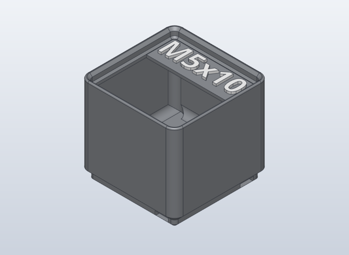
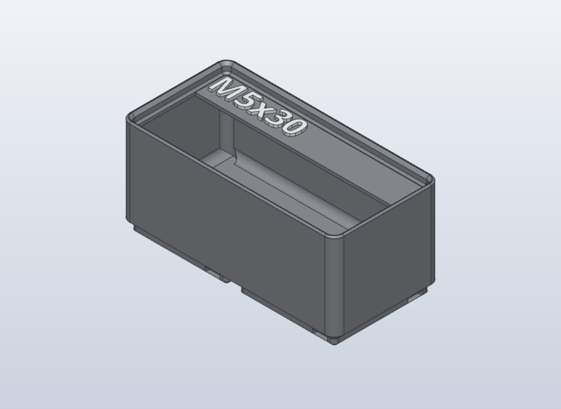

# Gridfinity bolt bins

Labelled Gridfinity bins for M5 and M6 socket head screws and for M3 to M6 heat-set inserts. They match the "Complete Metric Bolts M3,4,5,6 LABELED Gridfinity" bins (MakerWorld 946272) already in the drawer: 5 units high with a stacking lip, a finger scoop at the front, a label ledge at the back with raised two-colour text, and Gridfinity Refined slot-in pockets for 6 × 2 mm magnets. The model is our own parametric SolidCraft design, rebuilt from measurements of the original meshes.

## Bins

A screw lies flat on the floor along the bin's width. A bin gets as many cells as needed for length + head height (ISO 4762: head height = d) + 2 mm to fit the flat floor (34.18 mm in a 1x1, 76.18 mm in a 1x2). `tools/build.py` computes this per label (`cells_for`).

| Label | Size | Design | Print (one bin) | Time | PETG HF grey + white |
| --- | --- | --- | --- | --- | --- |
| M5x8 | 1x1 | `cad/M5x8.solidcraft` | `orca/bins/M5x8.3mf` | 1h 2m 30s | 20.90 g + 0.76 g |
| M5x10 | 1x1 | `cad/M5x10.solidcraft` | `orca/bins/M5x10.3mf` | 1h 2m 28s | 20.90 g + 0.77 g |
| M5x12 | 1x1 | `cad/M5x12.solidcraft` | `orca/bins/M5x12.3mf` | 1h 2m 21s | 20.90 g + 0.77 g |
| M5x14 | 1x1 | `cad/M5x14.solidcraft` | `orca/bins/M5x14.3mf` | 1h 2m 15s | 20.90 g + 0.77 g |
| M5x16 | 1x1 | `cad/M5x16.solidcraft` | `orca/bins/M5x16.3mf` | 1h 2m 35s | 20.90 g + 0.77 g |
| M5x18 | 1x1 | `cad/M5x18.solidcraft` | `orca/bins/M5x18.3mf` | 1h 2m 30s | 20.90 g + 0.77 g |
| M5x20 | 1x1 | `cad/M5x20.solidcraft` | `orca/bins/M5x20.3mf` | 1h 2m 41s | 20.90 g + 0.78 g |
| M5x25 | 1x1 | `cad/M5x25.solidcraft` | `orca/bins/M5x25.3mf` | 1h 2m 19s | 20.90 g + 0.78 g |
| M5x30 | 1x2 | `cad/M5x30.solidcraft` | `orca/bins/M5x30.3mf` | 1h 14m 2s | 33.64 g + 0.78 g |
| M6x8 | 1x1 | `cad/M6x8.solidcraft` | `orca/bins/M6x8.3mf` | 1h 2m 34s | 20.90 g + 0.76 g |
| M6x10 | 1x1 | `cad/M6x10.solidcraft` | `orca/bins/M6x10.3mf` | 1h 2m 39s | 20.90 g + 0.78 g |
| M6x12 | 1x1 | `cad/M6x12.solidcraft` | `orca/bins/M6x12.3mf` | 1h 2m 21s | 20.90 g + 0.77 g |
| M6x14 | 1x1 | `cad/M6x14.solidcraft` | `orca/bins/M6x14.3mf` | 1h 2m 29s | 20.90 g + 0.77 g |
| M6x16 | 1x1 | `cad/M6x16.solidcraft` | `orca/bins/M6x16.3mf` | 1h 2m 38s | 20.90 g + 0.77 g |
| M6x18 | 1x1 | `cad/M6x18.solidcraft` | `orca/bins/M6x18.3mf` | 1h 2m 22s | 20.90 g + 0.78 g |
| M6x20 | 1x1 | `cad/M6x20.solidcraft` | `orca/bins/M6x20.3mf` | 1h 2m 38s | 20.90 g + 0.78 g |
| M6x25 | 1x1 | `cad/M6x25.solidcraft` | `orca/bins/M6x25.3mf` | 1h 2m 41s | 20.90 g + 0.78 g |
| M6x30 | 1x2 | `cad/M6x30.solidcraft` | `orca/bins/M6x30.3mf` | 1h 14m 6s | 33.64 g + 0.78 g |
| M3 HSI | 1x1 | `cad/M3_HSI.solidcraft` | `orca/bins/M3_HSI.3mf` | 1h 2m 18s | 20.90 g + 0.77 g |
| M4 HSI | 1x1 | `cad/M4_HSI.solidcraft` | `orca/bins/M4_HSI.3mf` | 1h 2m 31s | 20.90 g + 0.77 g |
| M5 HSI | 1x1 | `cad/M5_HSI.solidcraft` | `orca/bins/M5_HSI.3mf` | 1h 2m 25s | 20.90 g + 0.77 g |
| M6 HSI | 1x1 | `cad/M6_HSI.solidcraft` | `orca/bins/M6_HSI.3mf` | 1h 2m 16s | 20.90 g + 0.77 g |

HSI = heat-set inserts.

## Print

`orca/Gridfinity_Bolt_Bins.3mf`: all bins on one plate, Bambu Lab P1S, 0.20 mm Standard, Bambu PETG HF on the Textured PEI Plate (assumption: the plate in use), AMS with grey in slot 1 and white in slot 2. One plate, 22 bins: 10 h 28 min, 367.2 g grey and 3.7 g white (OrcaSlicer estimate).

`orca/bins/<label>.3mf` holds a single bin. In every 3MF a bin is one object of two parts: the bin on filament 1, the text on filament 2, so it prints in one go and changes colour only for the 5 text layers. No supports; no brim.

## Hardware

None. Magnets are optional: 6 × 2 mm, pushed into the slots under each corner from the side. A pin through the narrow slot in the bottom pushes one out again.

## Model

`tools/build.py` is the source of truth: it writes the SolidCraft command list for one bin (`--label`, `--cells`, `--no-magnets`). Every length is a user parameter with a comment; the cell counts are `cx`/`cy`, the text is the editable sketch text of the last sketch. `tools/make.sh` rebuilds `cad/<label>.solidcraft`, the STLs in `stl/` (print orientation; `<label>.stl` the bin, `<label>_text.stl` the text in the same frame) every 3MF and `images/`; it stops on a kernel warning or nudged boolean in any design, on text nearer than 1 mm to the lip, and on an OrcaSlicer error. `tools/live.py` builds a bin step by step in a running SolidCraft GUI and stops on a kernel warning or nudged boolean; the full checks run only in `make.sh`. `tools/flatten_profile.py` wrote the Orca profiles in `orca/settings`.

Differences from the original bins (measured on its meshes):

- Text: Noto Sans Bold (installed on this machine), 1 mm raised, capital height 7.5 mm. `make.py` centres each text on the ledge by its measured outline and shrinks it only where it would come nearer than 1 mm to the lip (the HSI labels: 7.29 mm). The original uses Bambu Studio's default font at size 12 (capital height 8.8 mm); Noto is wider, and "M5x30" would not fit the ledge at that size.
- Label ledge top 0.2 mm (one layer) lower than the lip bottom, at 34.8 mm. Flush with the lip's edge the kernel has to nudge the cut.
- The scoop meets floor and front wall at 6 degrees instead of tangentially (a tangent cut is nudged by the kernel too); it reaches the same 15 mm up the wall and along the floor.
- The magnet push-out slot is a straight 2.5 mm slot through the bottom (2.53 to 8.18 mm from the magnet centre, up to half the pocket height); the original's slot rises as a ramp.
- The lip's top is a 0.85 mm flat with a 0.6 mm rounding on the outside instead of a fully round tip; overall height is the same 38.55 mm.

Not test-printed yet. The label ledge's underside is 54 degrees from vertical, the same overhang as the original bins, which print without support. Assumptions: the 2 mm a lying screw needs beyond its length, and that no brim is needed.
